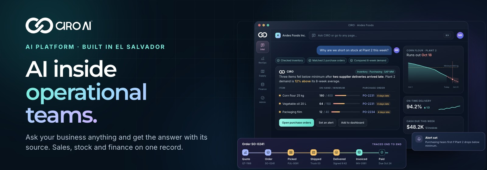
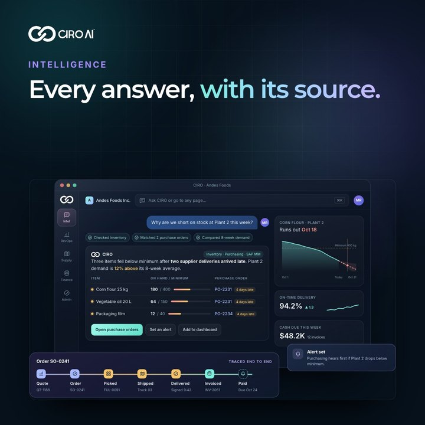
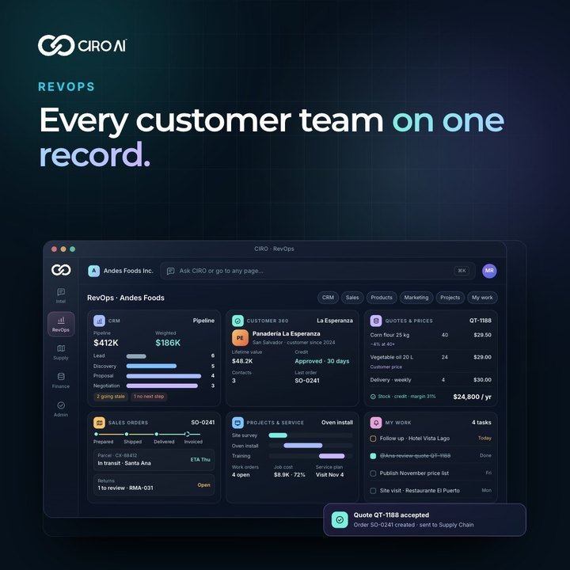
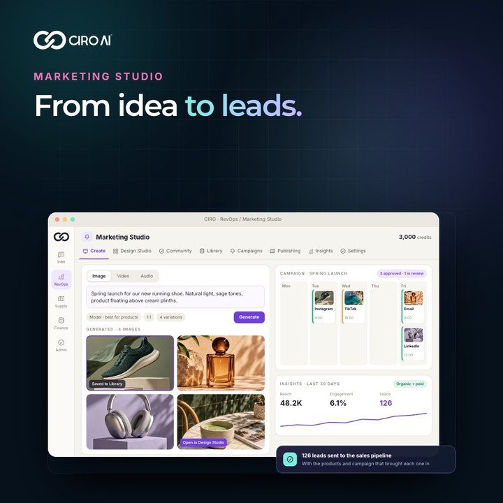
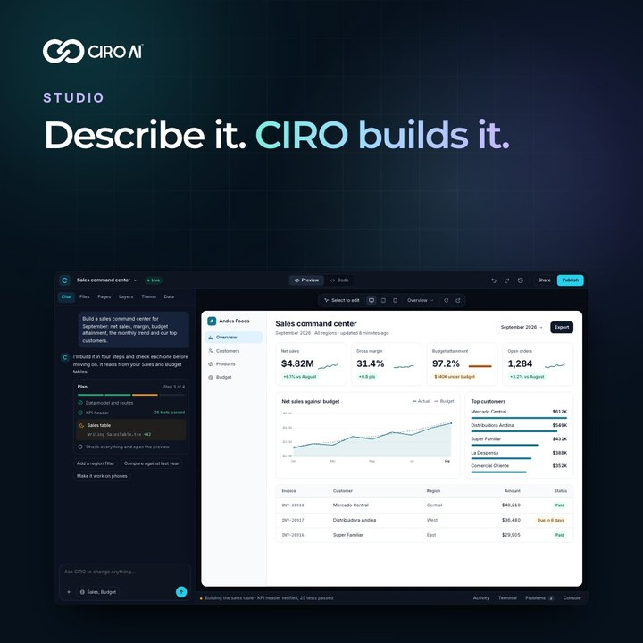

  

  
  
  
  
  

## AI inside operational teams

**CIRO AI** connects to your ERP, spreadsheets and databases and answers any question with its source, in English or Spanish. Then your team sells, markets, delivers and gets paid from the same record.

<table>
  <tr>
    <td align="center" width="33%"> <b>Intelligence</b> Ask in plain words. Get the chart, the query and the source.</td>
    <td align="center" width="33%"> <b>RevOps</b> CRM, quotes, orders and projects on one record.</td>
    <td align="center" width="33%"> <b>Supply chain</b> Inventory, purchasing, production and fleet, with alerts before you run out.</td>
  </tr>
  <tr>
    <td align="center" width="33%"> <b>Marketing Studio</b> AI images, video and campaigns on your data, every lead to the pipeline.</td>
    <td align="center" width="33%"> <b>Studio</b> Describe an app, dashboard or website. CIRO builds it on your data.</td>
    <td align="center" width="33%"> <b>Study</b> Flashcards, quizzes and podcasts from your own material.</td>
  </tr>
</table>

## How it works

1. **Connect, read-only.** ERPs (SAP ECC and S/4HANA included), spreadsheets, databases and business apps. Nothing changes in the source.
2. **Ask in plain words.** Every answer shows the query and the systems behind it, then becomes a dashboard, an alert or a forecast.
3. **Run the operation.** Sales, marketing, stock and finance on the same record, and Studio builds the apps your team needs.

On SAP or another ERP? **[CIRO Connect](https://ciroai.us/ciro-connect/?utm_source=github&utm_medium=profile)** takes your operation live in about four weeks.

## Private by default

Each company's data is kept separate with row-level security, each person sees only what they should, connections are read-only, and your data never trains a model. [Read more](https://ciroai.us/security/?utm_source=github&utm_medium=profile).

## Built in San Salvador

CIRO is built by **CIRO Technology Labs, S.A. de C.V.** for operational teams in Central America, Mexico, Colombia and the United States.

## Launching November 4, 2026

Join the waitlist at **[ciroai.us](https://ciroai.us/?utm_source=github&utm_medium=profile)** for 30% off your first 3 months and a chance to win one of 5 Ultra licenses.

Questions? <a href="mailto:hello@ciroai.us">hello@ciroai.us</a> · <a href="https://ciroai.us/contact/?utm_source=github&utm_medium=profile">Talk to us</a>

